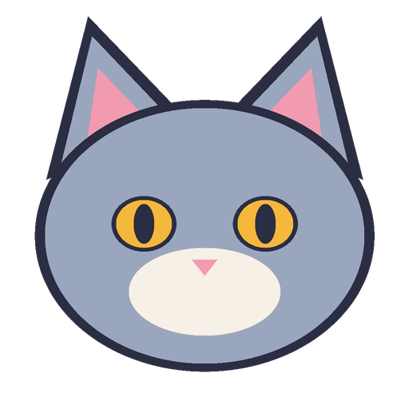
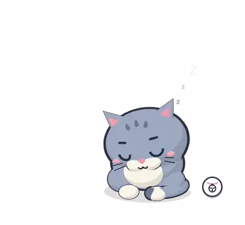
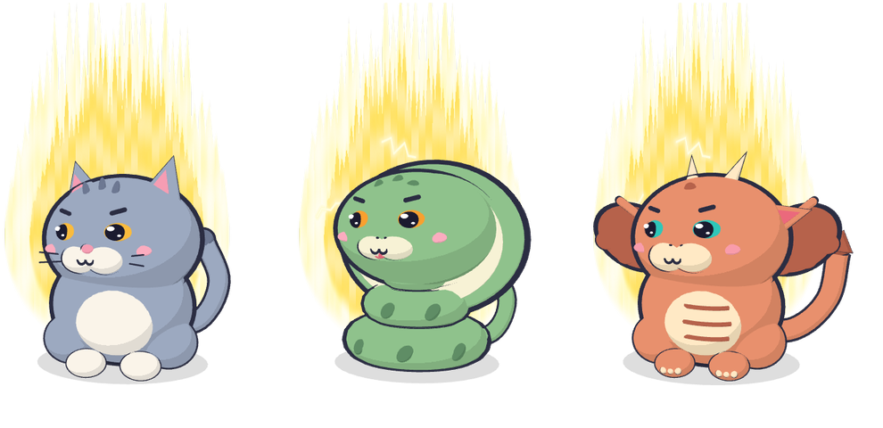
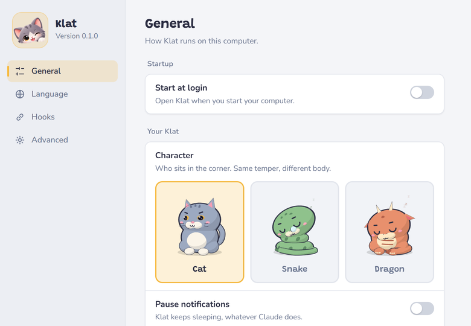
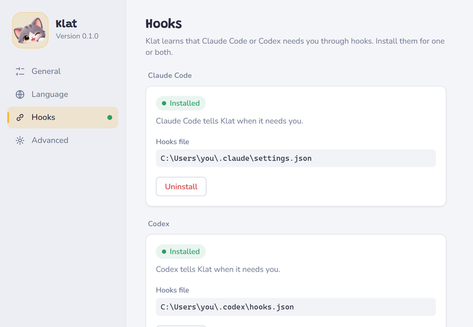
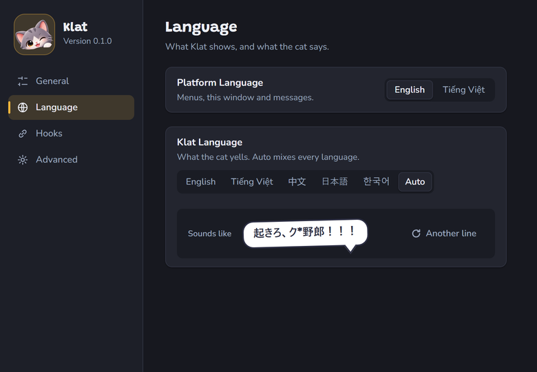

<p align="center">
  
</p>

<h1 align="center">Klat</h1>

<p align="center">
  <b>A grumpy desktop cat that yells at you when Claude Code or Codex needs you.</b>
</p>

<p align="center">
  <a href="LICENSE"></a>
  
  
  
</p>

<p align="center">
  <a href="../../releases/latest"><b>Download</b></a> ·
  <a href="docs/user-guide.md">User guide</a> ·
  <a href="docs/development.md">Build from source</a>
</p>

<p align="center">
  
</p>

You give Claude a long task and switch to something else. Claude finishes, or stops to ask for permission, and you
don't notice for twenty minutes.

Klat fixes that. A cat sleeps in the corner of your screen. When your agent needs you, it jumps up in a blaze of
golden aura and yells until you come back. Answer the agent and something flies in and knocks the cat out cold.

## Features

- **Wakes when it matters.** Permission requests and questions always wake it. Finished turns wake it too (**Ready**),
  until you tuck it into the little Aladdin lamp beside it: then only the lamp takes room on your screen.
- **Claude Code and Codex CLI.** Install the hooks for one or both with a click.
- **Gets knocked out when you're back.** A frying pan, a durian, a rubber duck, a bánh mì, an anvil, or one of
  five other things.
- **A real desk pet.** Pet it, hold <kbd>Space</kbd> and drag it anywhere, make it bigger or smaller, or hide it
  while it sleeps.
- **Speaks five languages.** English, Tiếng Việt, 中文, 日本語 and 한국어, or a mix of all five. SFW mode
  takes out the swearing.
- **Three characters.** Same temper, different body.
- **Light and private.** 2.6 MB installer, almost no CPU while asleep, no telemetry, nothing leaves your machine.

<p align="center">
  
</p>

## Install

**Windows 10 / 11**

1. Download `Klat_<version>_x64-setup.exe` from [Releases](../../releases/latest) and run it. No admin rights
   needed.
2. Click the cat icon in the tray, then **Settings → Hooks → Install** for Claude Code, Codex, or both.
3. Restart your Claude Code or Codex sessions. With Codex, also type `/hooks` and trust Klat's entries.

Klat isn't code-signed yet, so Windows SmartScreen will warn you. You can check the file first: the hash from
`Get-FileHash Klat_<version>_x64-setup.exe` must match `SHA256SUMS.txt` on the release page.

**macOS 11+ (preview)**

Download `Klat_<version>_universal.dmg` (Apple Silicon and Intel). It isn't notarized yet, so follow
[the first-open steps](docs/macos-install.md). The macOS build hasn't been tested on a real Mac yet, so
[bug reports](../../issues) are very welcome.

## How it reacts

| When | The cat |
|---|---|
| The agent asks for permission or waits for your input | Wakes up with its aura and yells, again every 30 seconds |
| The agent finishes a turn | Wakes you, unless you tucked it into the lamp (Ready off) |
| You reply, approve, or click the bubble | Gets knocked out and falls back asleep |
| Several sessions need you | Yells for each one and names the project |
| You click it | Asleep: grumbles. Awake: purrs |

The cat never takes keyboard focus, and clicks on the empty space around it pass through to the window behind.
More in the [user guide](docs/user-guide.md#using-it).

## Settings

<table>
  <tr>
    <td></td>
    <td></td>
  </tr>
  <tr>
    <td align="center">Pick a character, choose when it shows up</td>
    <td align="center">One-click hooks for Claude Code and Codex</td>
  </tr>
</table>

<p align="center">
  
</p>

## Privacy

- Everything runs on your machine. No account, no cloud, no telemetry.
- The hooks report to the app over `127.0.0.1` only. They send the event name, session id, project folder name
  and tool name, and never your prompts, code or transcripts.
- The hooks never approve or deny anything for you.

Details in [SECURITY.md](SECURITY.md) and the [user guide](docs/user-guide.md#privacy).

## Troubleshooting

| Problem | Try this |
|---|---|
| The cat doesn't wake | Settings → **Hooks** must say **Installed** (click **Repair** if it says otherwise), then restart the agent session. For finished turns, the cat must be out of the lamp (Ready on) |
| The cat doesn't wake for Codex | In Codex, type `/hooks` and trust Klat's entries. Do it again after every **Repair** |
| A black or white box around the cat | Update the WebView2 runtime and your GPU driver |

Step-by-step checks: [hooks troubleshooting](docs/hooks-troubleshooting.md).

## Build from source

You need Node.js 20.19+, pnpm (`corepack enable`) and Rust stable.

```bash
pnpm install
pnpm tauri dev      # run the app with hot reload
pnpm check          # every test and lint
pnpm release        # Windows installer
```

Building, releasing, the architecture and the decisions log are in [docs/development.md](docs/development.md)
and [docs/ARCHITECTURE.md](docs/ARCHITECTURE.md).

## License

[MIT](LICENSE). The bundled fonts (Grandstander, Nunito) are under the SIL Open Font License: see
`src/assets/fonts/OFL-*.txt`.

Klat is an independent fan project. It is not made by, affiliated with or endorsed by Anthropic or OpenAI.
"Claude" and "Claude Code" are trademarks of Anthropic, and "Codex" is a trademark of OpenAI.
