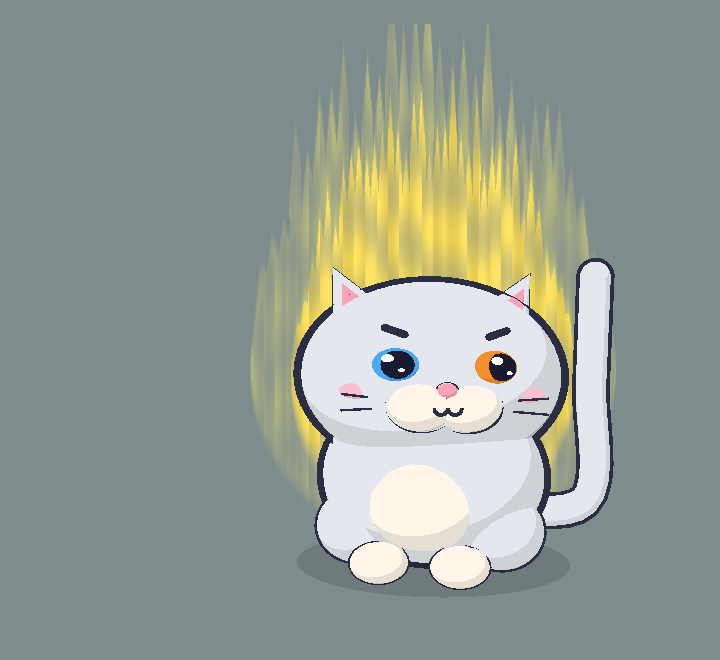
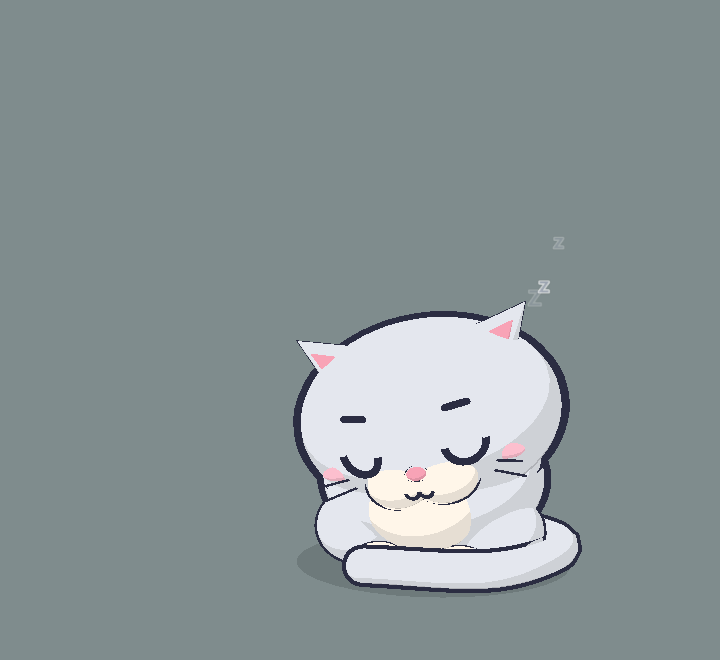

# Mèo Anh trắng (`british`): character sheet

> Quý tộc tròn ủm: một con mèo Anh lông ngắn trắng, mặt tròn bành, tai nhỏ, mắt hai màu, cái đuôi dài thượt dựng cao như dấu hỏi. Bị đánh thức thì không gào như dân thường mà khinh khỉnh: "Một quý ông không bắt Claude phải chờ."

 

Bảng 10 tư thế: [sheet.png](sheet.png). Code: `src/characters/british/BritishRig.ts`, một `CatLook` trên rig mèo `src/characters/cat/CatRig.ts` (cùng thân, mặt, chuyển động; chỉ khác tỉ lệ, màu, tai, đuôi).

## Brief

- **Ai**: mèo Anh lông ngắn (British Shorthair) màu trắng, theo yêu cầu của chủ dự án: "mèo Anh trắng đuôi dài".
- **Dấu nhận diện**: đầu tròn và rộng hẳn (má phúng); tai nhỏ, đặt xa nhau, nghiêng ra ngoài; thân chắc nịch; lông trắng.
- **Nét mới**: đuôi dài gần gấp rưỡi mèo, dựng cao vượt đầu khi thức và quấn trọn một vòng trước hai bàn chân khi ngủ; mắt hai màu (trái xanh dương, phải đồng), kiểu mèo trắng odd-eyed.
- **Tính cách / sắc thái cau có**: kiêu kỳ quý tộc Anh. Chửi bằng giọng lịch sự lạnh tanh, mỉa mai thay vì gào; coi việc bị đánh thức là một sự xúc phạm đến dòng dõi.
- **Bản quyền**: không áp dụng (giống mèo thật).

## DNA

| Mục | Giữ nguyên? | Nếu lệch: lệch gì, vì sao |
|---|---|---|
| Dựng khối từ primitive, tỉ lệ chibi, ngồi, 3/4 | Giữ nguyên | Đầu (1.42, 1.02, 1.08) rộng hơn mèo 9%, thân (1.22, 0.95, 1.04) rộng hơn 6%: trong ±15% |
| Toon 3 bậc, đèn chuẩn | Giữ nguyên | |
| Viền mực inverted hull | Giữ nguyên | |
| Khuôn mặt Klat | Giữ nguyên | Mắt to hơn (1.1), xa hơn (x 0.5); mõm kem to hơn chút. Mống mắt hai màu qua `palette.irisLeft` (kit) |
| Cau có mặc định, 5 trạng thái mặt | Giữ nguyên | |
| Lò xo, squash, thở, nhịp nền | Giữ nguyên | Rig mèo dùng chung |
| Hiệu ứng chung | Giữ nguyên | Dời ra ngoài một chút cho đầu rộng hơn |
| Bong bóng thoại, giọng | Giữ nguyên | |

## Bảng màu

| Vai trò | Hex | Ghi chú (qua luật màu thế nào) |
|---|---|---|
| main | `#E1E4EA` | **Lệch có chủ đích**: sáng ~89%, trên mức 55–75% vì chủ dự án muốn mèo trắng. Ngả xám xanh nhẹ nên dải sáng nhất không cháy thành mảng trắng phẳng; dải giữa và dải tối vẫn tách rõ (đã xem ảnh) |
| shade | `#A4ABBB` | Xám xanh, tối hơn main ~25%: chữ Zzz. Không có hoa văn |
| light | `#FBF2E6` | Kem ngà ấm: bụng, mõm, bàn chân; ấm hơn main nên vẫn tách được trên lông trắng |
| accent | `#F4A1B3` | Hồng: mũi, lòng tai (mèo trắng mũi hồng) |
| iris | `#F08C2E` | Đồng, mắt phải; ấm, tương phản với lông lạnh |
| iris (trái) | `#4AA6F0` | Xanh dương, mắt trái: mắt hai màu |
| blush | `#F8BCCB` | Hồng nhạt hơn accent |

Chóp đuôi dùng main (không sẫm như mèo xám). 7 màu riêng tính cả mắt thứ hai, vượt luật 6 màu một màu: mắt hai màu là nét mới chính nên giữ. Đọc rõ trên nền tối `#1E1F24` và nền xám (đã chụp cả hai).

## Khối

Như mèo (`CatRig`), trừ:

| Bộ phận | Primitive | Vị trí | Scale / kích thước | Màu | Viền |
|---|---|---|---|---|---|
| Thân | ellipsoid | (0, 0.95, 0) | (1.22, 0.95, 1.04) | main | 1.06 |
| Đầu | ellipsoid | (0, 2.05, 0.1) | (1.42, 1.02, 1.08) | main | 1.06 |
| Tai ×2 | cone mèo ×0.84 | gốc (±0.84, 0.66, −0.05), nghiêng ra 0.48 | | main / lòng accent | 1.06 / không |
| Đuôi | tube 4 điểm | thức (0.55, 0.45, −0.75) → (1.7, 0.55, −0.7) → (1.95, 1.85, −0.55) → (2.3, 3.0, −0.45); ngủ (0.55, 0.35, −0.7) → (1.4, 0.27, 0.05) → (0.8, 0.24, 1.2) → (−0.55, 0.22, 1.25) | r 0.17 | main | +0.04 |
| Chóp đuôi | ellipsoid | cuối đuôi | 0.165 | main | 1.25 |
| Ria | cylinder INK | x ±0.78 (theo bề rộng đầu) | | INK | không |

Vị trí khuôn mặt: mắt `(0.5, 0.06, 0.93)` yaw `0.34` scale `1.1`; miệng `(0, −0.35, 1.15)`, há `(0, −0.45, 1.11)`; má `(0.88, −0.2, 0.8)`; mõm `(0.24, −0.34, 0.93)` scale `(0.33, 0.25, 0.24)`; mũi `(0, −0.18, 1.1)`.

## Ánh xạ pose

Như mèo (rig dùng chung):

| Tham số | Nơi nhận | Cách áp (công thức) |
|---|---|---|
| sleepy | Đầu gục, đuôi dài quấn trọn trước hai bàn chân | lerp điểm đuôi thức → ngủ |
| ear | Tai xoay ở gốc | `rotation.z = −s·(0.48 + (1 − ear)·0.5)` |
| earTw | Tai giật | như mèo |
| tailUp | Đuôi dựng, vẫy nhanh | như mèo |
| swish | Đuôi quất khi bị chọc lúc ngủ | như mèo |
| puff | Thân +8%, tai +15%, đuôi to ra | như mèo |
| tapping | Chân trước phải gõ | như mèo |

## Hiệu ứng

Zzz `(2.25, 2.6, 0.3)`, dấu giận `(0.95, 0.55, 1.0)`, sao `(1.05, 1.12, 0.55)`, cục u `(0.2, 0.93, 0.38)`, bóng r 1.5, aura rộng 5 lệch phải 0.1. Hitbox thức mở tới x +3.0, y 3.9 cho đuôi dài.

## Giọng

Chưa đưa vào app (câu thoại vẫn dùng chung). Gợi ý cho sau này:

- "Wake up, B**CH!!! One does not keep Claude waiting."
- "I was having tea. In my dreams. Thanks for that."
- "Dậy đi. Quý tộc như tao mà phải đi nhắc mày à?"
- "Mày làm nguội cả ấm trà trong mơ của tao rồi đấy."
- SFW: "Ahem. Claude requires your attention. Do try to keep up."

## Bài test Klat

| # | Mục | Đạt? | Ghi chú |
|---|---|---|---|
| 1 | Che thân → nhận ra mặt Klat | Đạt | Mắt hai đốm sáng, lông mày mực, ω, má hồng |
| 2 | Che mặt → không nhầm với mèo | Đạt | Đầu tròn bành, tai nhỏ thấp, đuôi dài vượt đầu; ngủ thì đuôi quấn trọn vòng trước chân |
| 3 | Tỉ lệ | Đạt | Đầu rộng hơn thân, ngồi, quay 3/4 |
| 4 | Viền | Đạt | Mọi khối đặc có viền; bụng, má, lòng tai không |
| 5 | Toon | Đạt | 3 dải phẳng, đọc được cả trên lông trắng |
| 6 | Cau có | Đạt | Mắt lim dim, lông mày chụm |
| 7 | Màu | Đạt (lệch có chủ đích) | main sáng hơn luật vì là mèo trắng; thêm mắt thứ hai; rõ trên nền tối và sáng |
| 8 | Pose | Đạt | Mọi tham số có nơi nhận; ảnh ngủ thấy rõ đuôi quấn |
| 9 | Dấu nhận diện | Đạt | Mặt tròn, tai nhỏ, lông trắng, đuôi dài đều thấy |
