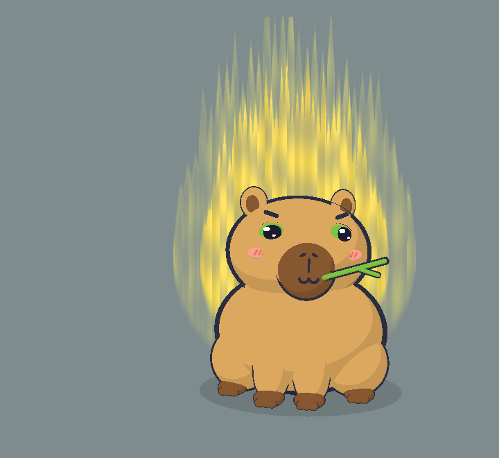

# Capybara (`capybara`): character sheet

> Ông hoàng bình thản: một con capybara hình quả lê màu nâu vàng, mõm tròn sẫm màu, ngậm cọng cỏ. Lúc agent làm việc thì nằm ngửa trên phao nhai cỏ như chẳng có gì trên đời đáng bận tâm; đến lúc cần bạn thì bật dậy với bộ mặt nghiêm trọng quá mức; bạn trả lời xong lại nằm xuống như chưa có gì xảy ra.

 

Bảng 10 tư thế: [sheet.png](sheet.png). Code: `src/characters/capybara/CapybaraRig.ts` (số liệu chính xác ở đó; bảng dưới là bản tóm tắt). Dáng theo ảnh tham khảo của chủ dự án (capybara chibi vector: thân quả lê, mõm tròn nâu sẫm, bàn chân sẫm có ngón).

## Brief

- **Ai**: chuột lang nước capybara (con vật, không phải nhân vật có bản quyền).
- **Dấu nhận diện**: dáng quả lê (đầu liền thân, thân phình to phía dưới); mõm tròn to màu nâu sẫm giữa mặt; tai ngắn tròn có lòng sẫm; bốn bàn chân sẫm có ngón.
- **Nét mới**: không có đuôi; phao bơi phồng lên quanh eo khi ngủ (nằm ngửa, nổi bập bềnh); cọng cỏ ngậm ở khoé miệng (nhai khi ngủ, ve vẩy khi sốt ruột); má hồng có gạch chéo.
- **Tính cách / sắc thái cau có**: bình thản tới mức lười. Không ồn ào như rồng, không mỉa như rắn, nhưng đã bị gọi dậy thì nghiêm trọng hoá mọi chuyện ("Đây là chuyện hệ trọng."). Xong việc là quên ngay.
- **Bản quyền**: không áp dụng (dáng con vật thật; chỉ lấy cảm hứng tỉ lệ từ ảnh tham khảo, dựng lại bằng khối Klat).

## DNA

| Mục | Giữ nguyên? | Nếu lệch: lệch gì, vì sao |
|---|---|---|
| Dựng khối từ primitive, tỉ lệ chibi, ngồi, 3/4 | **Lệch có chủ đích** | Thân rộng hơn đầu (thân 2.6, đầu 2.16) theo ảnh tham khảo: dáng quả lê là dấu nhận diện chính. Đầu vẫn chiếm gần nửa chiều cao, vẫn ngồi, vẫn quay 3/4. Không có bụng màu sáng |
| Toon 3 bậc, đèn chuẩn | Giữ nguyên | |
| Viền mực inverted hull | Giữ nguyên | Phao dùng một torus béo hơn làm viền (scale đều làm mỏng nét trên đỉnh ống); cọng cỏ dùng hull chỉ phình ngang (1.7, 1.06, 1.7) để đầu cọng không lòi mực |
| Khuôn mặt Klat | Giữ nguyên | Mắt nhỏ (0.9) và cách xa hơn mèo; không mõm kem, mõm là đĩa màu shade có lỗ mũi và nhân trung bằng nét mực; không mũi hồng, không ria; má hồng thêm 3 gạch chéo màu accent |
| Cau có mặc định, 5 trạng thái mặt | Giữ nguyên | |
| Lò xo, squash, thở, nhịp nền | Giữ nguyên | Lúc ngủ: đầu ngửa ra sau (cằm hếch) thay vì gục xuống, vì đang nằm thư giãn trên phao |
| Hiệu ứng chung | Giữ nguyên | Bóng đổ to hơn (r 1.6) cho vừa thân và phao |
| Bong bóng thoại, giọng | Giữ nguyên | |

## Bảng màu

| Vai trò | Hex | Ghi chú |
|---|---|---|
| main | `#D9A55E` | Nâu vàng như ảnh tham khảo, độ sáng ~61%: đủ 3 dải toon |
| shade | `#85562F` | Nâu sẫm: mõm, lòng tai, bàn chân, chữ Zzz. Tối hơn main nhiều hơn mức 20–30% của luật màu vì ảnh tham khảo dùng mảng sẫm hẳn; vẫn sáng hơn INK nên viền còn đọc được |
| light | `#F6EBDC` | Kem ấm: chỉ dùng cho vạch trắng trên phao |
| accent | `#EF6F5E` | Đỏ san hô: phao bơi, gạch chéo trên má |
| iris | `#7BC043` | Xanh lá cỏ, tương phản với lông ấm; cũng là màu cọng cỏ |
| blush | `#F4A08A` | Hồng cam như ảnh tham khảo, nhạt hơn accent |

Tổng 6 màu riêng (phao và cỏ dùng lại accent, light, iris). Đọc rõ trên nền tối `#1E1F24` và nền xám sáng (đã chụp cả hai).

## Khối

Toạ độ world tính từ gốc `root` (x 1.3, quay y −0.22); đầu là head-local. Thân, đùi, bàn chân sau nằm trong nhóm `lean` xoay quanh y 0.6 khi ngủ.

| Bộ phận | Primitive | Vị trí | Scale / kích thước | Màu | Viền |
|---|---|---|---|---|---|
| Thân | ellipsoid | (0, 0.95, 0) | (1.3, 0.95, 1.1) | main | 1.06 |
| Đùi sau ×2 | ellipsoid | (±0.88, 0.5, 0.15) | (0.5, 0.5, 0.62) | main | 1.06 |
| Bàn chân ×4 | ellipsoid + 3 ngón sphere | sau (±0.98, 0.1, 0.5); trước ở cuối chân | (0.22, 0.12, 0.26), ngón 0.065 | shade | 1.06 / 1.12 |
| Chân trước ×2 | ellipsoid, treo ở khớp (±0.3, 0.85, 0.72) | (0, −0.4, 0.1) so với khớp | (0.27, 0.46, 0.3) | main | 1.06 |
| Phao (chỉ khi ngủ) | torus | y 0.8 | R 1.45, ống 0.3, sâu ×0.9 | accent | torus béo hơn 0.055 |
| Vạch phao ×4 | cung torus 0.42 rad | cách đều 90° | ống 0.306 | light | không |
| Đầu | ellipsoid | (0, 2.2, 0.15) | (1.08, 0.82, 0.95) | main | 1.06 |
| Mõm | ellipsoid | (0, −0.28, 0.8) | (0.42, 0.44, 0.25) | shade | 1.08 |
| Lỗ mũi ×2 | ellipsoid nghiêng | (±0.085, −0.1, 1.02) | (0.05, 0.022, 0.02) | INK | không |
| Nhân trung | capsule | (0, −0.25, 1.05) | r 0.016, dài 0.18 | INK | không |
| Gạch má ×3 mỗi bên | capsule nghiêng | trên má | r 0.012, dài 0.07 | accent | không |
| Tai ×2 | ellipsoid + lòng tai | gốc (±0.7, 0.62, −0.05), quay ra ngoài 0.35 | (0.21, 0.24, 0.12) / (0.12, 0.15, 0.05) | main / shade | 1.08 / không |
| Cọng cỏ + lá | capsule | khoé miệng phải (0.2, −0.42, 0.99), chĩa ngang ra ngoài | r 0.035 dài 0.95; lá r 0.03 dài 0.3 | iris | hull ngang 1.7 |

Vị trí khuôn mặt: mắt `(0.5, 0.22, 0.72)` yaw `0.48` scale `0.9`; miệng `(0, −0.42, 1.045)`, há `(0, −0.5, 1.03)`; má `(0.68, −0.07, 0.7)`; mõm kem: không (đĩa mõm shade); mũi: không (lỗ mũi mực).

## Ánh xạ pose

| Tham số | Nơi nhận | Cách áp |
|---|---|---|
| sleepy | Nằm ngửa trên phao | phao phồng lên quanh eo khi sleepy 0.45 → 0.9; thân ngả ra sau 0.3 rad quanh y 0.6; đầu hạ 0.4, lùi 0.3, ngửa cằm 0.55 rad; cả con bập bềnh `(0.5 + 0.5·sin 1.3t)·0.06` và lắc `sin(0.9t)·0.035` |
| ear | Tai | `rotation.z = −s·(0.1 + (1 − ear)·0.6)`: dựng khi cảnh giác, cụp ngang khi ngủ |
| earTw | Tai giật | như tai mèo, biên độ 0.35 |
| tailUp | Cọng cỏ vểnh lên như điếu xì gà | không có đuôi; cỏ +`tailUp·0.3` rad khi thức |
| swish | Phao chòng chành khi bị chọc lúc ngủ | `sin(5.2t)·swish·0.09` |
| puff | Giật mình: thân, tai, phao phồng; cỏ dựng lên | thân +8%, tai +20%, phao +6%, cỏ +0.4 rad |
| tapping | Chân trước phải gõ + cọng cỏ ve vẩy kiểu ngậm tăm | chân nhấc `tapBeat(t)·0.35` rad; cỏ `tapBeat(t)·0.5` rad |

Nhai cỏ khi ngủ: mõm phồng xẹp 5% và cọng cỏ lên xuống theo `sin(7t)`. Nhai và bập bềnh là chuyển động trang trí, tắt khi `auraFlicker` là false (reduceMotion).

Ánh xạ với brief của chủ dự án: *bình tĩnh khi agent làm việc* = ngủ trên phao, nhai cỏ; *bật dậy nghiêm trọng* = wake (nhảy + puff có sẵn trong bộ não, phao xẹp, mặt cau có); *ngáp* = chuỗi ngủ `yawn`; *nằm xuống như chưa có gì* = phao phồng lại, quay về tư thế nổi.

## Hiệu ứng

Zzz `(2.0, 2.4, 0.3)`, dấu giận `(0.72, 0.5, 0.8)`, sao `(0.85, 0.95, 0.5)`, cục u `(0.15, 0.78, 0.33)` (đầu nhỏ hơn mèo nên tất cả thu vào), bóng r 1.6, aura rộng 4.8.

## Giọng

Chưa đưa vào app (câu thoại vẫn dùng chung). Gợi ý cho sau này:

- "Wake up. This is a matter of grave importance."
- "I was floating. Do you know how rare that is? ANSWER CLAUDE."
- "Dậy! Chuyện này hệ trọng lắm đấy!"
- "Tao đang nổi trên phao mà phải dậy vì mày đấy, biết chưa?"
- SFW: "Ahem. Your attention is required. Gravely."

## Bài test Klat

| # | Mục | Đạt? | Ghi chú |
|---|---|---|---|
| 1 | Che thân → nhận ra mặt Klat | Đạt | Mắt hai đốm sáng, lông mày mực, ω, má hồng |
| 2 | Che mặt → không nhầm với mèo | Đạt | Dáng quả lê, tai ngắn tròn, bàn chân sẫm có ngón, không đuôi; ngủ thì có phao |
| 3 | Tỉ lệ | Đạt (lệch có chủ đích) | Ngồi, quay 3/4; thân rộng hơn đầu theo ảnh tham khảo của chủ dự án |
| 4 | Viền | Đạt | Mọi khối đặc có viền; vạch phao, lòng tai, gạch má không |
| 5 | Toon | Đạt | 3 dải phẳng |
| 6 | Cau có | Đạt | Ảnh thức: mắt lim dim, lông mày chụm |
| 7 | Màu | Đạt | 6 vai trò; shade sẫm hơn luật (theo ảnh tham khảo) nhưng vẫn tách khỏi INK; rõ trên nền tối và sáng |
| 8 | Pose | Đạt | Mọi tham số có nơi nhận (tailUp là cọng cỏ); ảnh ngủ thấy rõ dáng nằm ngửa trên phao |
| 9 | Dấu nhận diện | Đạt | Quả lê, mõm tròn sẫm, tai tròn, bàn chân có ngón đều thấy |
