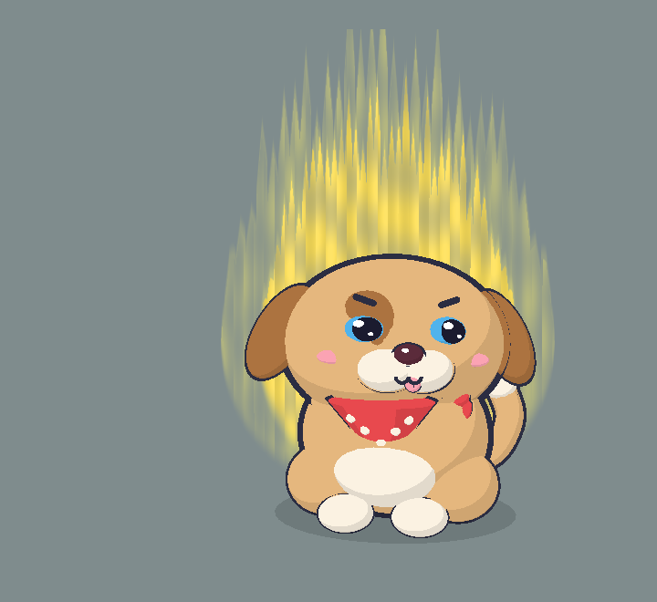

# Cún con (`puppy`): character sheet

> Bảo vệ tự phong: một con cún tròn ủm màu cát, tai cụp dài, một mắt có mảng nâu như bịt mắt cướp biển, đeo khăn yếm đỏ chấm bi, lúc nào cũng thè một mẩu lưỡi. Ngủ thì gục đầu lên khúc xương; bị gọi dậy thì sủa trước, hỏi sau.

 

Bảng 10 tư thế: [sheet.png](sheet.png). Code: `src/characters/puppy/PuppyRig.ts` (số liệu chính xác ở đó; bảng dưới là bản tóm tắt).

## Brief

- **Ai**: cún con (con vật, nhân vật gốc của Klat).
- **Dấu nhận diện**: tai cụp dài màu nâu rủ hai bên đầu; mõm kem với mũi nút to sẫm màu có đốm sáng; mảng nâu quanh một mắt.
- **Nét mới** (mèo không có): tai cụp vẫy ra khi cảnh giác; khăn yếm đỏ chấm bi kem có nút thắt bên cổ; lưỡi "blep" luôn thè ra, sốt ruột thì thở hộc hộc (lưỡi thụt ra thụt vào); đuôi ngắn mập chóp kem vẫy rất nhanh; ngủ ôm khúc xương giữa hai chân trước.
- **Tính cách / sắc thái cau có**: chó giữ nhà tự phong, trung thành mà cáu. Canh agent cả buổi, có biến là sủa ầm lên như báo động, rồi trách chủ không thèm nhìn mình. Ồn ào hơn mèo, kể công nhiều hơn mèo.
- **Bản quyền**: không áp dụng (con vật chung chung, không dựa trên nhân vật có sẵn).

## DNA

| Mục | Giữ nguyên? | Nếu lệch: lệch gì, vì sao |
|---|---|---|
| Dựng khối từ primitive, tỉ lệ chibi, ngồi, 3/4 | Giữ nguyên | Thân (1.12, 0.95, 1), đầu (1.32, 1, 1.05): gần như mèo |
| Toon 3 bậc, đèn chuẩn | Giữ nguyên | |
| Viền mực inverted hull | Giữ nguyên | Mảng bịt mắt, bụng, chấm bi là decal không viền |
| Khuôn mặt Klat | Giữ nguyên | Mắt 1.05; mõm kem to hơn mèo; mũi tự dựng màu MOUTH (sẫm) thay vì accent hồng, vì mũi chó đen; không ria |
| Cau có mặc định, 5 trạng thái mặt | Giữ nguyên | |
| Lò xo, squash, thở, nhịp nền | Giữ nguyên | Ngủ: đầu hạ 0.55, nhô 0.3 (hơn mèo) để cằm tựa lên xương |
| Hiệu ứng chung | Giữ nguyên | Aura rộng 5.0 cho vừa hai tai |
| Bong bóng thoại, giọng | Giữ nguyên | |

## Bảng màu

| Vai trò | Hex | Ghi chú |
|---|---|---|
| main | `#E2B47C` | Màu cát ấm, độ sáng ~69%: đủ 3 dải toon |
| shade | `#A9713F` | Nâu, tối hơn main ~23%: tai, mảng bịt mắt, Zzz |
| light | `#F7EEDF` | Kem ấm: mõm, bụng, bàn chân, chóp đuôi, xương, chấm bi |
| accent | `#E5484D` | Đỏ ấm: khăn yếm |
| iris | `#4FB0E8` | Xanh trời, tương phản với lông ấm |
| blush | `#F7A1B0` | Hồng nhạt hơn accent; cũng là lưỡi |

Tổng 6 màu riêng (khăn, xương dùng lại accent, light). Mũi dùng MOUTH chung. Đọc rõ trên nền tối `#1E1F24` và nền xám sáng (đã chụp cả hai).

## Khối

Toạ độ world tính từ `root` (x 1.3, quay y −0.22); đầu là head-local.

| Bộ phận | Primitive | Vị trí | Scale / kích thước | Màu | Viền |
|---|---|---|---|---|---|
| Thân | ellipsoid | (0, 0.95, 0) | (1.12, 0.95, 1) | main | 1.06 |
| Bụng | ellipsoid | (0, 0.7, 0.6) | (0.64, 0.5, 0.46) | light | không |
| Đùi sau ×2 | ellipsoid | (±0.78, 0.42, 0.25) | (0.47, 0.42, 0.56) | main | 1.06 |
| Bàn chân trước ×2 | ellipsoid | (±0.42, 0.17, 0.9) | (0.31, 0.2, 0.35) | light | 1.06 |
| Vòng cổ khăn | torus | y 1.5 | R 1, ống 0.1, scale (0.93, 0.86) | accent | 1.06 |
| Yếm khăn | cone dẹt lật ngược | (0, 1.08, 0.9), nghiêng π+0.22 | R 0.6, cao 0.78, sâu ×0.4 | accent | 1.06 |
| Chấm bi ×3 | ellipsoid | mặt trước yếm | 0.055 | light | không |
| Nút khăn + 2 đuôi | ellipsoid | (0.8, 1.46, 0.45) | (0.13, 0.11, 0.11); đuôi (0.06, 0.13, 0.05) | accent | 1.12 |
| Đầu | ellipsoid | (0, 2.05, 0.1) | (1.32, 1, 1.05) | main | 1.06 |
| Mảng bịt mắt | ellipsoid quay theo mặt đầu | (−0.43, 0.13, 0.82) | (0.4, 0.42, 0.16) | shade | không |
| Mũi nút | ellipsoid | (0, −0.16, 1.12) | (0.16, 0.11, 0.09) | MOUTH | 1.18 |
| Đốm sáng mũi | ellipsoid | trên-trái mũi | (0.04, 0.025, 0.02) | trắng | không |
| Lưỡi + rãnh giữa | ellipsoid + capsule | treo từ (0.06, −0.42, 1.08) | (0.085, 0.13, 0.05) | blush / INK | 1.12 |
| Tai cụp ×2 | ellipsoid treo ở khớp | khớp (±1.08, 0.5, 0.05), quay y ±0.25 | (0.32, 0.62, 0.17) | shade | 1.06 |
| Đuôi | tube 4 điểm | từ (0.6, 0.45, −0.7) cong lên bên phải | r 0.17 | main | +0.04 |
| Chóp đuôi | sphere | cuối đuôi | 0.19 | light | 1.25 |
| Xương (chỉ khi ngủ) | capsule + 4 sphere | (0.05, 0.2, 1.25) | thanh r 0.085 dài 0.62; núm 0.12 | light | 1.06 / 1.08 |

Vị trí khuôn mặt: mắt `(0.45, 0.1, 0.9)` yaw `0.32` scale `1.05`; miệng `(0, −0.4, 1.13)`, há `(0, −0.48, 1.1)`; má `(0.8, −0.2, 0.78)`; mõm kem `(0.2, −0.32, 0.9)` scale `(0.33, 0.25, 0.25)`; mũi: tự dựng (MOUTH).

## Ánh xạ pose

| Tham số | Nơi nhận | Cách áp |
|---|---|---|
| sleepy | Gục đầu lên xương | đầu hạ 0.55, nhô 0.3; xương lớn dần khi sleepy 0.45 → 0.9; đuôi cuộn quanh chân |
| ear | Tai cụp | `rotation.z = s·(0.12 + ear·0.3·awake)`: rủ sát đầu khi ngủ, vểnh ra khi cảnh giác |
| earTw | Tai giật | tai trái hất lên 0.5, tai phải 0.15 |
| tailUp | Đuôi vẫy | `sin(t·(7 + tailUp·7))·(0.32 + tailUp·0.3)`, đuôi dựng thêm `tailUp·0.3` |
| swish | Đuôi đập khi bị chọc lúc ngủ | `sin(5.2t)·swish·0.7` |
| puff | Giật mình: thân +8%, hai tai hất ra +0.45 rad, đuôi to thêm 0.06 | |
| tapping | Thở hộc hộc | lưỡi dài thêm `tapBeat(t)·0.6`, lắc `sin(10t)·0.12`; ngực phập phồng `tapBeat·0.02` |

Lưỡi còn dài thêm khi được vuốt (`happy·0.35`) và khi há miệng (`mouth·0.2`). Đuôi lắc nhẹ lúc ngủ là chuyển động trang trí, tắt khi `auraFlicker` là false.

## Hiệu ứng

Zzz `(2.2, 2.5, 0.3)`, dấu giận `(0.86, 0.62, 0.95)`, điểm va chạm `(0.05, 0.95, 0.25)`, sao `(1.05, 1.08, 0.6)` (rộng hơn mèo để vòng ra ngoài tai), cục u `(0.2, 0.9, 0.4)`, bóng r 1.45, aura (5.0, 6.6).

## Giọng

Chưa đưa vào app (câu thoại vẫn dùng chung). Gợi ý cho sau này:

- "WOOF! Intruder alert! Oh wait, it's just Claude needing you. AGAIN."
- "I guarded this desk ALL DAY and you can't even look at me?!"
- "Gâu! Có biến! Dậy mà xem con agent nó hỏi kìa!"
- "Tao canh nhà cho mày cả buổi, mày nhìn tao một cái thì chết à?"
- SFW: "Woof! Human! Your attention, please. Good human."

## Bài test Klat

| # | Mục | Đạt? | Ghi chú |
|---|---|---|---|
| 1 | Che thân → nhận ra mặt Klat | Đạt | Mắt hai đốm sáng, lông mày mực, ω, má hồng |
| 2 | Che mặt → không nhầm với mèo | Đạt | Tai cụp dài thay cho tai nhọn, khăn yếm đỏ, đuôi ngắn chóp kem; ngủ thì có xương |
| 3 | Tỉ lệ | Đạt | Đầu rộng hơn thân, ngồi, quay 3/4 |
| 4 | Viền | Đạt | Mọi khối đặc có viền; bụng, mảng bịt mắt, chấm bi không |
| 5 | Toon | Đạt | 3 dải phẳng |
| 6 | Cau có | Đạt | Ảnh thức: mắt lim dim, lông mày chụm (lưỡi blep làm cái cau có thêm buồn cười) |
| 7 | Màu | Đạt | 6 vai trò, qua luật màu; rõ trên nền tối và sáng |
| 8 | Pose | Đạt | Mọi tham số có nơi nhận; ảnh ngủ thấy rõ gục đầu lên xương |
| 9 | Dấu nhận diện | Đạt | Tai cụp, mũi nút, mảng bịt mắt đều thấy |
