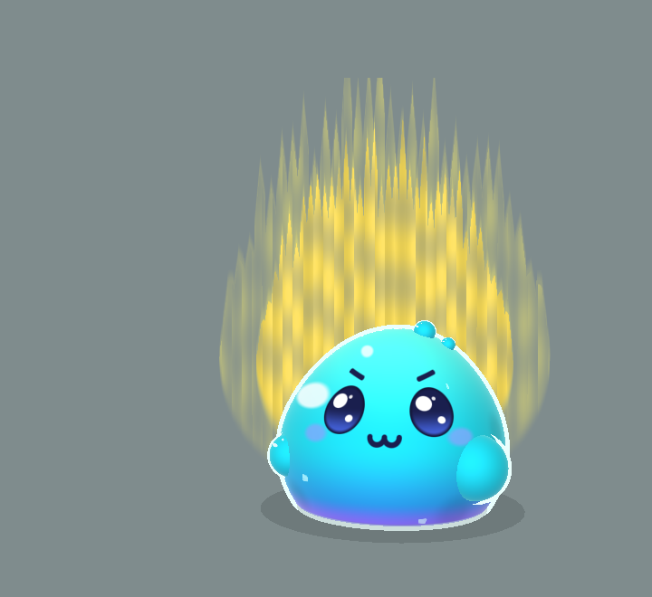
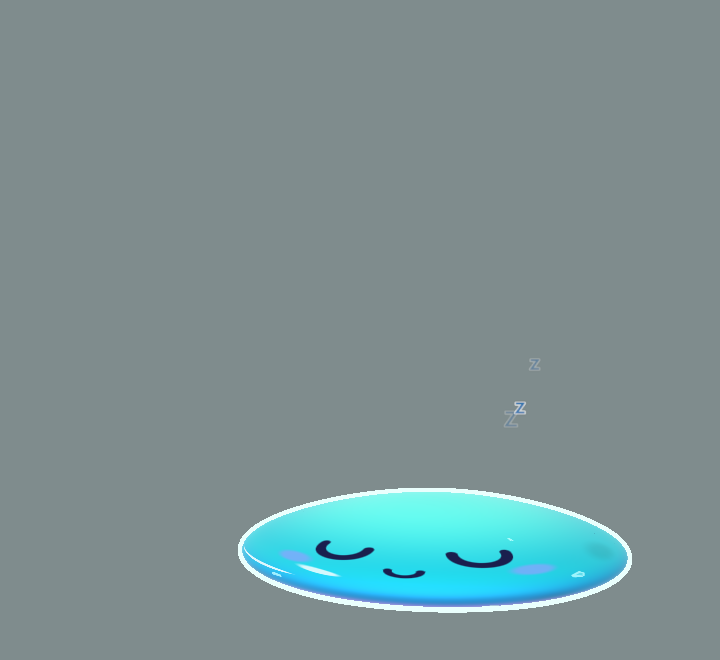

# Slime (`slime`): character sheet

> Sinh vật biến hình: một cục thạch xanh ngọc tròn trịa, bóng loáng. Lúc agent làm việc thì chảy thành vũng nước nằm ngủ; đến lúc cần bạn thì gom mình lại, bật dậy, nảy tưng tưng; tiếp đất, bị vuốt hay bị chọc thì rung rinh như thạch.

 

Bảng 10 tư thế: [sheet.png](sheet.png). Code: `src/characters/slime/SlimeRig.ts` (rig) và `src/characters/slime/gel.ts` (dáng, chất liệu và khuôn mặt, đều trong shader).

**Thử nghiệm nét vẽ mới.** Theo yêu cầu của chủ dự án, slime **không** dùng nét Klat (toon 3 dải, viền mực, khuôn mặt dựng bằng khối). Nó được vẽ theo ảnh tham khảo: thạch bóng trong mờ, viền sticker trắng, mặt kawaii. Nếu hướng này ổn, chất liệu gel có thể làm skin cho nhân vật khác; nếu không, chỉ cần xoá thư mục này.

## Brief

- **Ai**: slime (sinh vật tưởng tượng, không phải nhân vật có bản quyền).
- **Dấu nhận diện**: dáng giọt thạch lùn (đáy phẳng rộng, đỉnh tròn, rộng hơn cao); màu chuyển xanh ngọc → xanh dương → viền tím ở đáy; bóng loáng; mắt to đen ánh xanh với hai đốm sáng; hai cục tròn hai bên như tay.
- **Nét mới**: thân biến dạng liên tục (chảy thành vũng, rung gel, lắc lư); khuôn mặt **vẽ thẳng lên mặt thạch** nên co giãn, rung theo thân và không bao giờ bị thân che; mặt trượt trên thạch theo hướng nhìn; hai giọt nhỏ trên đỉnh thay tai; dễ đổi skin.
- **Tính cách / sắc thái cau có**: vẫn tính khí Klat (lông mày chụm, miệng ω, chửi khi cần bạn), nhưng vỏ ngoài dễ thương: lông mày chỉ là hai nét nhỏ, mắt chỉ sụp nhẹ khi cau có.
- **Bản quyền**: không áp dụng.

## Khác với DNA của Klat

| Mục | Klat | Slime |
|---|---|---|
| Dựng khối | Ghép primitive cứng | Một sphere 96×72 bị shader bẻ thành giọt thạch mỗi frame; tay và giọt trên đỉnh là sphere cùng chất liệu |
| Chất liệu | Toon 3 dải, đèn chuẩn | Shader gel: dải màu theo chiều cao, ánh sáng mềm, sáng dồn vào giữa như thạch trong, viền sáng lạnh (fresnel), hai vệt sáng ở góc trên trái |
| Viền | Mực `#2B2D42`, inverted hull | Sticker trắng xanh `#EAFFFD`, hull bằng cách đẩy đỉnh theo pháp tuyến trong shader |
| Hoa văn | Decal phẳng | 4 đốm mờ và 4 bong bóng vẽ trong shader, tránh vùng mặt |
| Khuôn mặt | Bộ mặt Klat bằng khối (`kit/face.ts`) | Vẽ bằng SDF trong shader, trên toạ độ kinh độ / vĩ độ của sphere: mắt bầu dục to (tối trên, ánh xanh dưới, 2 đốm sáng + 1 tia lấp lánh), má hồng xanh, miệng. Giữ đủ 5 trạng thái của Klat (mở, ∪ ngủ, ∩ vui, ✕ bất tỉnh, há miệng) và cùng ngưỡng (`eye < 0.18` là ∪) |
| Chuyển động | Lò xo, squash, thở | Giữ hết (cùng bộ não), thêm rung gel, nảy tưng khi hăng, chảy thành vũng |
| Hiệu ứng | Aura, Zzz, dấu giận, knockout | Giữ hết; "đầu" là đỉnh thạch |

## Skin (`GelSkin`)

| Vai trò | Hex | Dùng cho |
|---|---|---|
| top / mid / bottom | `#4FF0E2` / `#1BBFD0` / `#2A86DE` | Dải màu từ đỉnh xuống đáy |
| base | `#8166F2` | Viền tím sát đáy |
| glint | `#D8FFFB` | Viền sáng, bong bóng |
| line | `#EAFFFD` | Viền sticker |
| eyeDark / eyeLight | `#1A1F4E` / `#4A6CF0` | Mắt (và mọi nét trên mặt) |
| blush | `#8FA2FF` | Má |
| mouth / tongue | `#8A2142` / `#FF8098` | Trong miệng, lưỡi |

`CharacterPalette` chỉ còn dùng cho hiệu ứng chung: shade `#1D6FB8` (chữ Zzz), main `#2FC6CF` (cục u knockout). Skin mới = một `GelSkin` khác; dáng, mặt và chuyển động giữ nguyên.

## Dáng

Sphere đơn vị → thân (`shape()` trong shader; `gelRadii()` và `gelHeight()` là bản CPU, phải khớp):

- Nắp dưới `y < −0.6` ép phẳng thành đáy; `t = (y + 0.6) / 1.6` là độ cao 0..1.
- Bề ngang `(1.2 − 0.2t)` × bán kính sphere × (1.2, 1.12) theo x/z; cao 2.15. Rộng nhất khoảng 2.7, nên lùn và tròn hơn cao.
- Chảy (`sleepy`): cao còn 32%, đáy loe thêm 45%, đỉnh thêm 20%.
- Rung: sóng `sin(3·góc + 9t)` quanh thân và `sin(7·độ cao − 11t)` dọc thân, mạnh dần lên đỉnh; cao co giãn `sin(13t)`. Giới hạn 1.6.
- Lắc lư: đỉnh lệch ngang `sway·t²`.

Mặt: tâm ở vĩ độ 0.25 rad; mắt ở (±0.38, 0.1), miệng (0, −0.12), má (±0.6, −0.1), theo đơn vị mặt (radian × 0.9).

## Ánh xạ pose

| Tham số | Nơi nhận | Cách áp |
|---|---|---|
| sleepy | Chảy thành vũng | `uMelt = sleepy`; mặt nằm trên vũng (dẹt theo thân); tay và giọt trên đỉnh tan vào |
| eye, happy, dizzy | Mắt vẽ trong shader | như bộ mặt Klat; cau có (eye 0.62) chỉ sụp mí còn ~85% |
| grumpy | Hai nét lông mày nhỏ + miệng ω | lông mày hiện dần từ grumpy 0.15; miệng ω khi grumpy > 0.5, cười nhỏ khi không |
| mouth | Miệng chữ D có lưỡi | rộng `0.12 + 0.05·mouth`, sâu `0.06 + 0.16·mouth` |
| lx, ly, yawn | Mặt trượt trên thạch, đỉnh lắc theo | mặt dời (0.22·lx, −0.14·ly) rad; sway 0.3·lx |
| ear | Hai giọt trên đỉnh | nhô lên 0.16 khi cảnh giác, chìm khi không |
| earTw | Giọt nảy, đỉnh lắc | giọt ±0.06; sway +0.08 |
| tailUp | Tay phải giơ lên, nảy tưng tưng | tay +0.3 nhấp nhô `sin 8t`; thân nhảy `|sin 7t|·0.16` |
| swish | Rung gel + hai tay lắc | jiggle +1.2 |
| puff | Phồng to, rung mạnh | thân +8% ngang +6% cao; tay +15%; giọt +25%; jiggle +1.2 |
| tapping | Tay phải gõ | `tapBeat(t)·0.18` |
| happy, purring | Rung gel | jiggle +0.4 (+1 khi rừ rừ) |
| squash, jumpY | Toàn thân như mèo, và rung khi tiếp đất | jiggle +3·|squash| |

Rung nền (0.25) và nảy khi hăng là chuyển động trang trí, tắt khi `auraFlicker` là false (reduceMotion).

## Giọng

Chưa đưa vào app (câu thoại vẫn dùng chung). Gợi ý:

- "BLORP. I'm solid now. Answer Claude before I melt again."
- "I literally pulled myself together for this."
- "Dậy! Tao vừa phải gom mình lại từ vũng nước đấy!"
- "Rung rinh vì tức chứ không phải vì dễ thương đâu!"
- SFW: "Blorp! Your turn, human."

## Kiểm tra

| Mục | Kết quả |
|---|---|
| Đủ 10 tư thế đúng chỗ (ngủ, thức, chửi, vuốt, ngáp, bị chọc, 4 knockout) | Đạt |
| Mặt không bao giờ bị thân che, kể cả khi rung, nảy, chảy thành vũng | Đạt (vẽ trên mặt thạch) |
| Vệt sáng không đè lên mặt | Đạt |
| Đọc rõ trên nền tối và sáng | Đạt |
| Thẻ trong Settings nằm gọn | Đạt |
