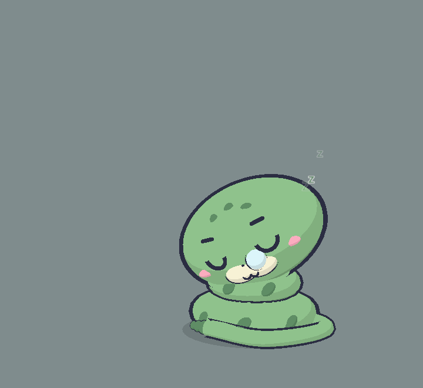

# Rắn (`snake`): character sheet

> Một con hổ mang cuộn tròn, mặt Klat, cau có kiểu khinh khỉnh: bành mang, lắc chuông đuôi rè rè, thè lưỡi "chậc chậc" khi bạn bắt nó chờ. Lúc ngủ thì hiền: gối má lên vòng cuộn, thổi bong bóng mũi.

 

Bảng 10 tư thế: [sheet.png](sheet.png). Code: `src/characters/snake/SnakeRig.ts` (số liệu chính xác ở đó; bảng dưới là bản tóm tắt).

## Brief

- **Ai**: rắn hổ mang (con vật, không phải nhân vật có bản quyền).
- **Dấu nhận diện**: thân cuộn tầng, mang bành sau đầu, lưỡi chẻ.
- **Nét mới**: không ngồi mà cuộn 3 tầng; mang bành thay tai; chuông đuôi rè rè; thè lưỡi thay gõ chân; ngủ thì thổi bong bóng mũi.
- **Tính cách / sắc thái cau có**: khinh khỉnh, mỉa mai, kéo dài chữ "sss". Ít nhảy dựng hơn mèo, nhưng bành mang và rít khi chửi.
- **Bản quyền**: không áp dụng.

## DNA

| Mục | Giữ nguyên? | Nếu lệch: lệch gì, vì sao |
|---|---|---|
| Dựng khối từ primitive, tỉ lệ chibi, ngồi, 3/4 | Giữ, trừ "ngồi" | Rắn không có chân: cuộn 3 tầng (torus) thay dáng ngồi; vẫn neo ở đất, đầu rộng hơn thân (2.7 so với 2.32), quay 3/4 |
| Toon 3 bậc, đèn chuẩn | Giữ nguyên | |
| Viền mực inverted hull | Giữ nguyên | Lưỡi mảnh không viền, như nét mực |
| Khuôn mặt Klat | Giữ nguyên | Không mũi hồng, thay bằng 2 lỗ mũi mực; không ria |
| Cau có mặc định, 5 trạng thái mặt | Giữ nguyên | |
| Lò xo, squash, thở, nhịp nền | Giữ nguyên | Thở bằng cả chồng vòng cuộn |
| Hiệu ứng chung | Giữ nguyên | |
| Bong bóng thoại, giọng | Giữ nguyên | |

## Bảng màu

| Vai trò | Hex | Ghi chú |
|---|---|---|
| main | `#8DBF8A` | Xanh xô thơm, độ sáng ~64%, hơi xám: đủ 3 dải toon |
| shade | `#5D8B63` | Cùng tông, tối hơn ~25%: đốm thoi, chuông đuôi, chữ Zzz |
| light | `#F3EED2` | Kem ấm: mõm, cổ họng, mặt trước mang |
| accent | `#E8677A` | Hồng đỏ: lưỡi |
| iris | `#F59E2E` | Cam hổ phách, tương phản với lông lạnh màu xanh |
| blush | `#F7A9BC` | Hồng, nhạt hơn accent |

Đọc rõ trên nền tối `#1E1F24` và nền xám sáng (đã chụp cả hai).

## Khối

Toạ độ world tính từ gốc `root` (x 1.3, quay y −0.22); đầu là head-local.

| Bộ phận | Primitive | Vị trí | Scale / kích thước | Màu | Viền |
|---|---|---|---|---|---|
| Vòng cuộn 1–3 | torus nằm ngang | y 0.38 / 0.95 / 1.45 | R 0.8/0.55/0.3, ống 0.36/0.32/0.28, dẹt 0.85 | main | 1.06 |
| Đốm thoi ×5 | ellipsoid | mặt ngoài vòng 1–2 | (0.15, 0.1, 0.06) xoay 45° | shade | không |
| Cổ | ellipsoid | (0, 1.75, 0.05) | (0.42, 0.6, 0.42) | main | 1.06 |
| Cổ họng | ellipsoid | (0, 1.7, 0.3) | (0.3, 0.45, 0.2) | light | không |
| Đầu | ellipsoid | (0, 2.2, 0.15) | (1.35, 0.92, 1.05) | main | 1.06 |
| Mang | ellipsoid sau đầu | (0, −0.15, −0.42) | (1.7·spread, 1.25, 0.22) | main + mặt trước light | 1.06 |
| Đốm trán ×3 | ellipsoid | trán | (0.12, 0.08, 0.05) | shade | không |
| Lỗ mũi ×2 | sphere | (±0.07, −0.17, 1.04) | 0.025 | INK | không |
| Lưỡi chẻ | capsule ×3 | (0, −0.39, 1.04), chúi xuống 1.0 rad | thân 0.26 + 2 nhánh | accent | không |
| Đuôi | tube 4 điểm | từ sau vòng 1 | r 0.13 | main | tube |
| Chuông đuôi | 3 hạt ellipsoid | đầu đuôi, theo hướng đuôi | 0.15 → 0.095 (nhỏ đi 25% khi ngủ) | shade | 1.12 |
| Bong bóng mũi | sphere + đốm sáng trắng | (0.2, −0.13, 1.08) | 0.05 ↔ 0.17 theo nhịp thở | `#D8F1F6` | 1.12 |

Vị trí khuôn mặt: mắt `(0.45, 0.1, 0.9)` yaw `0.32` scale `1`; miệng `(0, −0.33, 1.1)`, há `(0, −0.42, 1.06)`; má `(0.8, −0.15, 0.8)`; mõm: có (±0.17, hẹp hơn mèo); mũi: không (lỗ mũi mực).

## Ánh xạ pose

| Tham số | Nơi nhận | Cách áp |
|---|---|---|
| sleepy | Đầu nghiêng gối má lên vòng trên, mang thu gọn, đuôi ôm sát vòng dưới; bong bóng mũi khi đã ngủ say | đầu y −0.35, z +0.15, nghiêng thêm 0.22 rad; mang nhỏ đi 35%; đuôi nội suy A→Z; bong bóng hiện khi `zzz` và không bị chọc |
| ear | Mang bành | rộng `1.7 · (0.55 + 0.45·ear)` |
| earTw | Mang rung | `rotation.z = earTw · 0.12` |
| tailUp | Đuôi dựng + chuông rè | đuôi nâng 0.35; chuông lắc `sin(45t)·0.05·tailUp` |
| swish | Đuôi quất + chuông rè khi bị chọc lúc ngủ | như trên |
| puff | Mang và thân phồng | mang +15%, thân +6%, đuôi dày thêm |
| tapping | Thè lưỡi | độ dài lưỡi = `tapBeat(t)`; khi chửi lưỡi thè hẳn và ngoáy |

## Hiệu ứng

Như mèo, chỉnh cho đầu cao hơn: Zzz `(2.1, 2.4, 0.3)`, dấu giận `(0.9, 0.55, 0.95)`, sao `(1.0, 1.05, 0.55)`, cục u `(0.18, 0.85, 0.38)`, bóng r 1.35.

## Giọng

Chưa đưa vào app (câu thoại vẫn dùng chung). Gợi ý cho sau này:

- "Sssseriously? Claude's DONE. Move it."
- "I could ssswallow your keyboard whole, you know."
- "Ssss… dậy đi, đồ lười biếng!"
- "Xong rồi đó. Đừng bắt tao rít lần nữa."
- SFW: "Pssst. It'sss your turn."

## Bài test Klat

| # | Mục | Đạt? | Ghi chú |
|---|---|---|---|
| 1 | Che thân → nhận ra mặt Klat | Đạt | Mắt hai đốm sáng, lông mày mực, ω, má hồng, mõm kem |
| 2 | Che mặt → không nhầm với mèo | Đạt | Cuộn tầng + mang bành: bóng dáng khác hẳn |
| 3 | Tỉ lệ | Đạt | Đầu 2.7 rộng hơn vòng dưới 2.32; quay 3/4. Không ngồi (có lý do ở DNA) |
| 4 | Viền | Đạt | Vòng cuộn, đầu, mang, chuông có viền; đốm, cổ họng không |
| 5 | Toon | Đạt | 3 dải phẳng |
| 6 | Cau có | Đạt | Ảnh thức: mắt lim dim, lông mày chụm |
| 7 | Màu | Đạt | 6 vai trò, qua luật màu, rõ trên nền tối và sáng |
| 8 | Pose | Đạt | Mọi tham số có nơi nhận; ảnh ngủ thấy đầu nghiêng gối lên vòng cuộn, thấy rõ các tầng thân |
| 9 | Dấu nhận diện | Đạt | Cuộn tầng, mang bành, lưỡi chẻ đều thấy |
