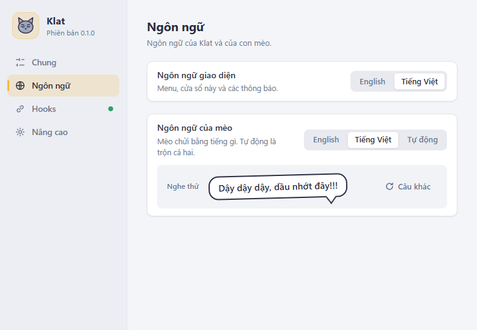

# Verification log

What was checked at the end of each phase, how, and on what machine. Newest first. The decisions behind these results are in the README's decisions log.

## Architecture refactor: baseline and regression script (2026-10-16, Windows 11 Pro 22621)

Epic ClauCat-dv6 (plan: [ARCHITECTURE.md](ARCHITECTURE.md) §11). Every phase of the refactor is compared with the
numbers below and must pass the regression script. Tools: `pnpm check` (every gate), `pnpm measure` (the table
below), `pnpm regress` (the automated part of the regression script).

### Baseline

Measured at `563b20e` plus the Phase 0 scripts and the ClauCat-dfd fix (one test added, klat-hook unchanged),
win32-x64, rustc 1.99.0, 50 hook runs per case (wall time including process start).

| What | Median | p95 |
|---|---|---|
| klat-hook, app not running (no runtime.json) | 3.0 ms | 3.5 ms |
| klat-hook, runtime.json points at a closed port | 167.7 ms | 176.2 ms |
| klat-hook, app answers 204 | 5.1 ms | 6.8 ms |
| Edit-test loop: touch `src-tauri/src/session_store.rs`, `cargo test -p klat` | 2881.0 ms | (3 runs) |

| What | Value |
|---|---|
| klat-hook release binary | 245.0 KB (250880 bytes) |
| Rust tests passed (`cargo test --workspace`) | 124 (1 ignored) |
| TypeScript tests passed (`pnpm test`) | 108 |

A phase may not make klat-hook more than 10% larger or slower, nor lower the test counts (a removed test needs a
replacement named in the bead's notes).

**After Phase 1 step 2** (klat-hook builds `HookEvent` and reads `RuntimeInfo` from klat-protocol, ClauCat-dv6.2.2):
binary 239.5 KB (−2.2%); medians 2.9 ms / 166.0 ms / 3.8 ms for the three cases above (p95 4.2 / 174.8 / 4.3);
Rust tests 129 (the five data-folder tests no longer run twice; klat-protocol adds 15). `pnpm regress`: 16/16
through the new hook.

**After Phase 2** (klat-core, ClauCat-dv6.3, at `9e925a7`): the edit-test loop now touches
`crates/klat-core/src/session.rs` and runs `cargo test -p klat-core`, which compiles no Tauri: median 544 ms, 5.3×
faster than the 2881 ms baseline. klat-hook unchanged at 239.5 KB; medians 3.1 / 168.4 / 3.9 ms (p95 3.4 / 180.1 /
4.7). Rust tests 160: klat-core 95 (session, time, geometry, settings, claude_hooks, i18n, cat), app 35. `pnpm
regress`: 16/16. Not covered by the script, left for the owner: dragging the cat with Space, and a DPI change with
a dragged cat (the coordinates got types, ClauCat-dv6.3.2).

**After Phase 3** (klat-infra, ClauCat-dv6.4, at `aa47d2d`): klat-hook unchanged at 239.5 KB; medians 3.1 / 162.2 /
4.2 ms (p95 3.6 / 173.5 / 5.2); edit-test loop 541 ms. Rust tests 166: klat-infra 36 (log, event_server with 2000
seeded junk requests, runtime_file, settings_repo, claude_settings), app 5. `pnpm regress`: 16/16; its log check now
fails on any line that is not one of Klat's messages, and `pnpm regress --hold 300` (five more minutes of the debug
app running) left 17 lines, none from Tauri, wry or tao.

**After Phase 4, agent part** (the app shell, ClauCat-dv6.5, at `d1ee3e2`; debug build, Windows 11 Pro 22621):
klat-hook unchanged at 239.5 KB; medians 3.0 / 166.1 / 3.9 ms (p95 3.5 / 178.6 / 5.0); edit-test loop 546 ms. Rust
tests 173: app 12 (CatService 5, TrayAction 2). `pnpm check --mac` green (shown to compile `platform/macos.rs`).
`pnpm regress`: 18/18, with two new checks for what Phase 4 moved: events reach the overlay page (now sent by
subscribers), and the size slider preview (its state is now `OverlayState`). Each new check was seen failing on a
deliberate regression (state emit removed; preview emit removed). Owner rows for Phase 4 below: not run yet.

### Regression script

**Automated: `pnpm regress`** (Windows, ~5 s after a warm build). Starts the debug app with `APPDATA` in a temp
folder (your settings, log and token are untouched, and your installed Claude Code hooks cannot reach it), sends
hook events through the real `klat-hook`, and reads the app's decisions over its own commands through WebView2
remote debugging. It never presses Install/Uninstall hooks or Start at login. Quit an installed Klat first (tray >
Quit). It checked, all ✅ on the code above:

| Check | Expected |
|---|---|
| At launch | asleep, Ready armed |
| Wire format | `cat://state` has exactly 6 keys, settings exactly 14 (catches serde renames) |
| Stop with Ready armed | wakes, reason `done`, project name from the cwd folder |
| Same Stop within 2 s | duplicate: no new yell (`attention.seq` unchanged) |
| UserPromptSubmit | asleep, `sleepCause` `user` |
| Ready off, then Stop | stays asleep |
| PermissionRequest | always wakes, reason `permission` |
| Notification `permission_prompt` on a waiting session | ignored (fallback only) |
| PostToolUse of that tool | clears the wait |
| Notification `idle_prompt`, then SessionEnd | wakes with `input`, then asleep with no sessions |
| Pause, PermissionRequest, resume, Dismiss | held asleep; wakes on resume with `sleepCause` `auto`; Dismiss sleeps with `user` |
| Wake test, Sleep | wakes with `done`, then asleep |
| `set_settings` | patch saved to settings.json; `position` and `startAtLogin` in a patch are ignored |
| Cat size 150% | overlay `devicePixelRatio` ×1.5, back to ×1 at 100% |
| Event server | wrong token 401, `Origin` 403, GET 405, unknown hook 422; the state does not change |
| Events | `cat://state` (wake test, sleep) and `cat://settings` reach a listener in the overlay page |
| Size slider | `preview_cat_scale` puts the overlay at the preview zoom (×2); `set_settings` releases it at the chosen size |
| Log | hook lines carry names only (no tool input), rejections are logged |

The script was checked against a deliberate regression (`DEDUPE_MS` set to 0, now `klat_core::session::DEDUPE_WINDOW`): it failed the duplicate check and
exited 1.

**Owner, by hand** (what the script cannot see; nothing clicks the tray or taskbar automatically). Run the rows the
phase touched:

| # | Check | Phases |
|---|---|---|
| O1 | Tray: tooltip counts waiting sessions; Ready and Pause ticks follow the bell and Settings; Dismiss all, Settings…, Quit work | 4 |
| O2 | Space-drag the cat, release: it stays; after a restart it comes back to the same spot | 2, 4 |
| O3 | Move a dragged cat to a monitor with another scale, or change the display scale: it keeps its corner and stays on screen | 2, 4 |
| O4 | Settings > size slider: smooth while dragging, the cat lands at the chosen size on release | 2, 4, 5 |
| O5 | Animations: wake with aura and yelling bubble; answering or Dismiss knocks the cat out (`user`); Pause makes it yawn (`auto`) | 2, 4, 5 |
| O6 | Settings > Language > Tiếng Việt: tray labels and the Settings window title switch without a restart | 4, 5 |
| O7 | macOS (on a Mac): overlay, menu bar icon, Space-drag after granting Accessibility | 4 (ClauCat-dv6.5.6) |
| O8 | Release build only, when a phase touches hooks or autostart: Settings > Hooks Install/Repair/Uninstall; Start at login on/off | 3, 4 |
| O9 | While awake the cat turns its head after the pointer; clicks pass through the overlay everywhere but the cat and bubble | 4 |
| O10 | Task Manager: Klat's memory drops a few seconds after the cat falls asleep and goes back up when it wakes | 4 |

Phase 4 (ClauCat-dv6.5.5) needs O1–O6 and O8–O10 on Windows, O7 on a Mac (ClauCat-dv6.5.6). Results go here, with the
date, the build and who ran them.

Stale expiry (`staleAfterMs`, at least 5 minutes) is too slow for the script; the session-store unit tests cover it.

## Security hardening (2026-10-16, release build `pnpm release`, Windows 11 Pro 22621)

Issue: ClauCat-fw3 (decisions in the README's decisions log, "Security hardening").

| Check | Result | How |
|---|---|---|
| Gates | ✅ | `pnpm lint`, `pnpm typecheck`, `pnpm test` (108), `pnpm lint:rust`, `pnpm test:rust` (103 + 14 + 6), `pnpm release` |
| Known vulnerabilities | ✅ | `pnpm audit`: none. `cargo audit` (cargo-audit 0.22.2, 1329 advisories): none; without `.cargo/audit.toml` it lists only the two Linux-only GTK advisories it ignores |
| pnpm | ✅ | 10.34.6 pinned with sha512; OSV lists no advisory for it. Lockfile v6 → v9 with the same 185 package versions |
| Slow-drip client cut off | ✅ | Test `a_slow_drip_is_cut_off_at_the_request_deadline` (real socket, one byte per 100ms): HTTP 400 within the 500ms deadline; it failed before the fix |
| No token in the temp folder | ✅ | Test `never_takes_the_runtime_file_from_the_temp_folder` runs the real hook with `APPDATA` empty; it failed before the fix |
| Release ignores `WEBVIEW2_ADDITIONAL_BROWSER_ARGUMENTS` | ✅ | Launched with `--remote-debugging-port`: the debug exe listened on the port, the release exe did not |
| Checksums | ✅ | `SHA256SUMS.txt` next to the installer matches `certutil -hashfile … SHA256` |

## Settings window and languages (2026-10-13, debug build under `pnpm tauri dev`, Windows 11 Pro 22621)

Spec: [docs/specs/settings-i18n-macos.md](specs/settings-i18n-macos.md). Driven through WebView2 remote debugging (`WEBVIEW2_ADDITIONAL_BROWSER_ARGUMENTS=--remote-debugging-port=9222`) and by the owner on the tray; nothing clicked the tray or taskbar automatically.

| Check | Result | How |
|---|---|---|
| Gates | ✅ | `pnpm lint`, `pnpm typecheck`, `pnpm test` (95), `pnpm lint:rust`, `pnpm test:rust` (96), `pnpm build` |
| An old `settings.json` with `languages` loads and is saved in the new shape | ✅ | The real file had `"languages": ["en","vi"]`; after the first change it had `uiLanguage: "en"`, `klatLanguage: "auto"` and no `languages`, other values kept |
| Opening Settings twice gives one window | ✅ | `open_settings` twice; one `settings.html` page |
| A switch in Settings applies at once | ✅ | SFW: switch on, `settings.json` `sfwMode: true`, overlay `get_settings` agrees |
| Stepper steps and clamps | ✅ | + gave 35 s (35000); typing 2 gave 5 s (5000) |
| Platform Language switches without restart | ✅ | Vietnamese: page text, native window title "Cài đặt Klat", overlay Ready tooltip; owner saw tray labels and tooltip change |
| Changes made elsewhere show up in the window | ✅ | `set_settings` from the overlay page: the Klat Language segment and the preview bubble followed |
| Hooks section reads the real status and path | ✅ | "Đã cài", `C:\Users\ADMIN\.claude\settings.json`. Install/Uninstall not pressed (it would point the hooks at the dev build) |
| Closing Settings frees its webview | ✅ | 7 → 6 processes, 474 → 401 MB working set (dev build with the debug port, so only the difference counts) |
| Tray has the 5 quick actions; Pause tick follows Settings; double-click opens Settings | ✅ | Owner, on the dev build |
| Klat Language Vietnamese on the real overlay | ✅ | Wake test: "Dậy dậy dậy, dầu nhớt đây!!!" with the aura (screenshot below) |
| Real window matches the approved design | ✅ | Screenshot of the window content below; design screenshots in `docs/images/settings-window/` |

 

Not checked yet:
- Start at login from Settings (toggling it from a dev build would point the Run entry at the dev exe). Check on the next release build.
- Install / Repair / Uninstall from Settings → Hooks on a release build.
- Keyboard-only use of the window (Tab, arrow keys in the sidebar and segmented controls, Enter/Escape in the stepper): only checked by reading the code, not by automation.
- Memory of a release build with Settings closed against the 150 MB target (ClauCat-gwd).

## Ready and aura (2026-10-11)

- Tests: 79 TS (poking the sleeping cat: eyes stay shut, angry mark and swish, calms down, no swish under reduceMotion, cleared on wake; aura burns, flares and goes out; steady under reduceMotion; Ready peek and perked ear survive a wake; the Ready reply follows the language filter and stays out of the yell pool) and 79 Rust (Gate: a finished turn needs Ready armed before it, permission and input always pass, pause beats everything; Ready stays armed across turns).
- End to end on the dev app, with fake hooks through `klat-hook.exe`:
  - Stop without Ready: the cat stays asleep.
  - PermissionRequest: the cat wakes with the aura; PostToolUse puts it back to sleep.
  - Ready button: `ready: true`, the button turns gold, the log says `ready armed`.
  - Prompt, then Stop: the cat wakes (`long-task:done`). The next prompt puts it to sleep and Ready stays on, so the next Stop wakes it again. Clicking the bell again turns Ready off (`ready off`), and a later Stop is ignored.
- Screenshots (dev page and real overlay): the button next to the paws, gold when armed with the cat's reply bubble; the gold flame shell around the awake cat on dark and light desktops.
- The release installer was rebuilt (2.14 MB).

## Phase 6 verification (2026-10-11, release build)

- `pnpm release` builds the hook (release), stages the sidecar, then builds the app and `Klat_0.1.0_x64-setup.exe` (2.13 MB). The NSIS script installs `klat-hook.exe` into `$INSTDIR` next to `klat.exe`.
- Silent install (`/S /D=<temp>`) exits 0. It creates `klat.exe`, `klat-hook.exe` and `uninstall.exe`, plus an HKCU uninstall entry.
- **Single instance:** launching the installed app a second time leaves one process, shows "Klat is already running…", and logs `second launch ignored`.
- **Start at login:** ticking it in the tray creates `HKCU\…\Run\Klat = <install dir>\klat.exe` and sets `startAtLogin: true`. Unticking removes the value and sets `false`.
- **Installed sidecar:** piping a Stop JSON into the installed `klat-hook.exe` exits 0, and the app logs `hook Stop … -> attention Done`. A UserPromptSubmit carrying a prompt is logged as `-> cleared`, and the prompt text appears nowhere in the log files.
- Tray → Quit logs `exiting` and deletes `runtime.json`. The silent uninstall exits 0 and removes the install folder and the uninstall entry.
- **CPU/RAM (release):** asleep ~0.35% of total CPU (WebView2 GPU 3.4% + renderer 3.3% of one core); awake ~0.55%; 185–189 MB private. Asleep there are 20 rAF/s and ~48 draw calls per frame. WebView2 flag experiments are under the README's Performance section.
- Tests: 69 TS, 75 Rust (60 app incl. 3 log tests and 14 installer tests, 9 hook unit, 5 hook binary, plus 1 ignored dry run).

## Phase 5 verification (2026-10-11)

- Unit tests (14) cover the installer:
  - It keeps existing hooks and key order.
  - Installing twice changes nothing.
  - Repair fixes paths and removes duplicates and stale events.
  - Uninstall removes only ours, including when our entry shares a group with theirs, and restores the original.
  - Broken JSON writes nothing and makes no backup.
  - A missing exe is refused before anything is touched.
  - A missing settings file is handled; backups are made; the newline style is kept.
- Dry run on a copy of the real `%USERPROFILE%\.claude\settings.json` (with the user's `rtk` PreToolUse hook): install, then uninstall, came back byte-identical.
- Real install, approved by the user, through tray → Hooks → Install. The message box confirmed it, one backup was written, the `rtk` hook is untouched, and 9 exec-form entries were added.
- Real Claude Code 2.1.296: `claude -p "Reply with exactly: OK"` in a folder `cat-e2e` → the overlay received `wake(done)` (Stop), then `sleep()` 30ms later (SessionEnd).
- Still to confirm interactively: a reply finishing in an open session wakes the cat; a permission prompt wakes it right away; the next prompt puts it to sleep.

## Phase 4 verification (2026-10-10)

- Tests: 43 app tests (session store mapping, dedupe, isolation between sessions, dismiss, pause, stale; HTTP parsing and every rejection; real-socket round trip; token; runtime file) and 14 hook tests (field extraction, no leaks, truncated input, basename, timeouts; 5 that run the real binary).
- End to end with the real app and `send-test-event.ps1` → `klat-hook.exe` → server:
  - Stop wakes the cat with "Wake up, B**CH!!!". A duplicate within 2s is ignored.
  - A second session's Stop makes the cat yell again with the project name. Each session's UserPromptSubmit clears only that session.
  - PermissionRequest(Bash) wakes the cat. A later `permission_prompt` is ignored. PostToolUse(Edit) does not clear the wait; PostToolUse(Bash) does.
  - `idle_prompt` wakes the cat; dismiss puts it to sleep; PreToolUse and SubagentStop change nothing.
- Live server probing with curl: valid 204; wrong or missing token 401; 70 KB body 413; unknown hook 422; broken JSON 400; `Origin` 403; GET 405; other path 404. It listens on 127.0.0.1 only.
- Hook timing with the app not running: 3–4 ms with no `runtime.json` (Tray → Quit deletes it), and ~160 ms with a stale `runtime.json` pointing at a closed port. Windows takes up to ~1s to refuse a loopback connection; the 150ms connect cap cuts that short.

## Phase 3 verification (2026-10-10)

- Head tracking (100%, screenshots): the head and pupils turn towards the cursor at top-left, top-right, just left of the cat, screen centre and below the cat.
- Events: ~29/s while the mouse moves, 0/s while it is still. The overlay point (100, 50) arrives as `100,50`.
- Cost: the 30Hz poller uses ~0.3% of one core in `klat.exe`. Total app CPU while awake is unchanged at ~6%.
- DPI: 100% passes the automated checks. The user switched to 125% with the app running, saw the cat correctly placed and sized, and switched back. After the round trip the window was pinned exactly in the corner again (16px gaps), which exercises the re-pin. The placement maths for 125% and 150%, and the cursor conversion at both, are unit-tested.
- Not tested on real hardware: 150% (only unit tests) and a second monitor (this machine has one).

## Phase 2 verification (2026-10-10, debug build under `pnpm tauri dev`, 2560×1440 at 100%, 165Hz, 20 logical cores)

| Check | Result |
|---|---|
| Window | 360×280 at the work-area corner; `WS_EX_TOPMOST` and `WS_EX_NOACTIVATE` are set |
| Click-through | Over empty overlay area the window under the cursor is the editor (`WS_EX_TRANSPARENT` on). Over the cat or the bubble it is the overlay (off). It switches back after dismiss. |
| Focus | With the editor focused, clicking the cat and clicking the bubble both leave the editor in the foreground |
| Tray | Wake test → wakes and yells; bubble click / Sleep → yawns and sleeps; SFW → "Wake up, human!!!"; Hide cat while sleeping → vanishes after the yawn and returns on wake; `settings.json` updates |
| FPS cap | Render 20fps asleep and 60fps awake (counted with WebView2 remote debugging) |
| CPU | Asleep 3.4% of one core (0.17% of total CPU); awake 7.4% of one core; hidden ≈ 0. Before the two loop fixes, asleep was 11.4%. |
| Memory | 204 MB private (app 5 MB, WebView2 GPU 90, renderer 55, browser 31, others 22); 397 MB working set. This is a dev build with Vite HMR, so the real measurement is in Phase 6. **It may exceed the 150 MB target**, because WebView2's processes alone take most of it. |

Known limitation: right after you use the tray, the foreground is a short-lived shell window. Clicking the bubble in that moment can make Windows hand focus to the overlay. With the terminal focused (the normal case), focus stays where it is.

Not checked yet: DPI scaling at 125/150% and multiple monitors (Phase 3). The hit-test maths is unit-tested at 150%.

## Phase 1 verification (2026-10-10)

- `pnpm typecheck`, `pnpm lint` and `pnpm test` (62 tests) pass.
- Side-by-side screenshots of the dev page against the prototype (headless Edge) for sleep, wake/yell, active, pet, look, yawn and asleep-again. Shape, colours and poses match.
- Allocation profiling with the heap sampling profiler, 5s while ACTIVE and following a moving cursor:
  - Prototype: ~10.5 MB/s, mostly from rebuilding `TubeGeometry` every frame.
  - Port: ~0.47 MB/s. All of the top allocators are inside `THREE.WebGLRenderer.render` (`updateMatrixWorld`, render-list sort), which V8 needs to box floats for. None of them are in `src/`.
  - A bare rAF loop allocates 0 B/frame on the same browser.
- Reduce motion: during wake, max |jumpY| and |squash| are ≈0, and the bubble has no shake class.
- The overlay window shows the sleeping cat, transparent over other windows, with Zzz floating.

## Phase 0 verification (2026-10-10, Windows 11 Pro 22621, WebView2 154, 2560×1440 at 100%)

| Check | Result | How |
|---|---|---|
| Transparent background | ✅ | Screenshot: pixels in the window but outside the sphere match the window behind it, and `alpha: true` + `setClearColor(0, 0)` works without any workaround |
| No border, title bar or shadow | ✅ | Screenshot |
| Not on the taskbar | ✅ | Taskbar screenshot shows no button |
| Always on top | ✅ | `WS_EX_TOPMOST` is set |
| Position | ✅ | Window rect (2184,1096)-(2544,1376): 360×280, 16px inside the work area (2560×1392) |
| Does not steal focus | ✅* | The foreground window stayed on the editor after launch. *Only checked at 100% DPI and on one launch. Phase 2 re-checks this together with click-through. |

Not checked yet: DPI scaling at 125/150% and multiple monitors (Phase 3).
